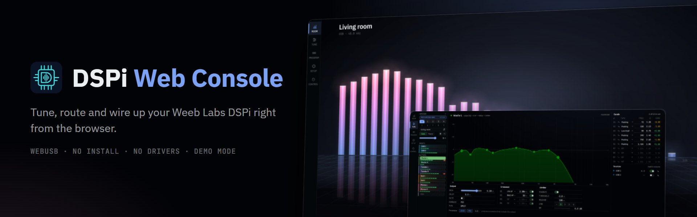

# DSPi Web Console

[](docs/media/promo.jpg)

A browser-based configurator for the [Weeb Labs DSPi](https://github.com/WeebLabs/DSPi). Runs entirely in the browser over WebUSB: no installer, no drivers.

[> Launch App <](https://dspi-ctrl.fyi) | [> Demo (w/o device) <](https://dspi-ctrl.fyi/?mock)

> **[dspi-ctrl.fyi](https://dspi-ctrl.fyi)** is the stable release. The rolling test build (latest `master`) is on [GitHub Pages](https://sigman78.github.io/dspi-web-console/).

[](https://github.com/sigman78/dspi-web-console/actions/workflows/ci.yml)
[](https://github.com/sigman78/dspi-web-console/actions/workflows/deploy.yml)

## What it does

- **Room**: a live spectrum of what the system is playing, read from the board's analyser, with one-click presets.
- **Tune**: per-output parametric EQ, crossovers, trim, delay and a lookahead limiter, drawn as one combined curve.
- **Program**: the routing matrix and the processing chain in firmware order (leveller, upmixer, crossfeed, subharmonic synth, bass enhancement, loudness).
- **Setup**: inputs, output types, clocks and a pin map showing which feature holds each GPIO.
- **Control**: bind knobs, buttons, LEDs, IR remotes and small displays on spare GPIOs to device functions.

Several units can be connected at once; switch between them from the **DEVICES** list.

[See every page →](docs/media/promo.jpg)

## Firmware

- **Minimum: DSPi fw 1.1.5.** Older firmware is asked to upgrade when it connects.
- **fw 1.1.6** is supported, including the room analyser, subharmonic synth, output limiter and the newer Control Surface features.
- Firmware newer than the console knows connects best-effort, reading only what it recognizes.

## Requirements

- A Chromium-based browser (Chrome, Edge, Brave, Opera).
- **Windows:** the DSPi vendor interface must be bound to **WinUSB** ([Zadig](https://zadig.akeo.ie/)), and only one app can hold it at a time.
- **Linux:** the browser needs a udev rule; the connect screen offers a one-liner, or install [`70-dspi.rules`](public/70-dspi.rules) yourself.
- Platform troubleshooting lives on the [Wiki](https://github.com/sigman78/dspi-web-console/wiki).

## Reporting issues

Use **Report an issue** on the ABOUT page: it fills in the console build and the firmware version for you. Mention the page and panel where it happened.

## Development

```bash
npm install
npm run dev          # http://localhost:5173, add ?mock to run without hardware
```

Setup, the mock device, tests, commit conventions and the release flow are in [CONTRIBUTING.md](./CONTRIBUTING.md). Shipped changes are in [CHANGELOG.md](./CHANGELOG.md).

## License

[](https://opensource.org/licenses/MIT)
